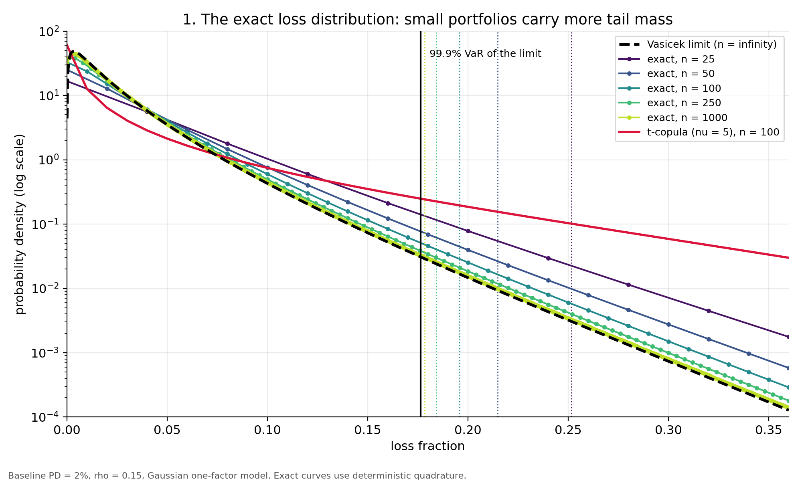
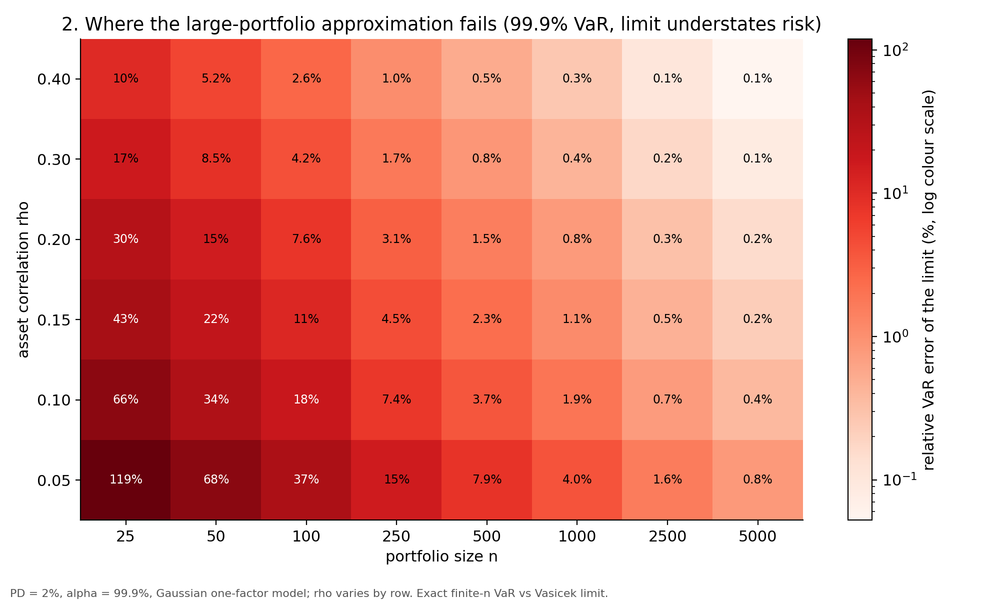
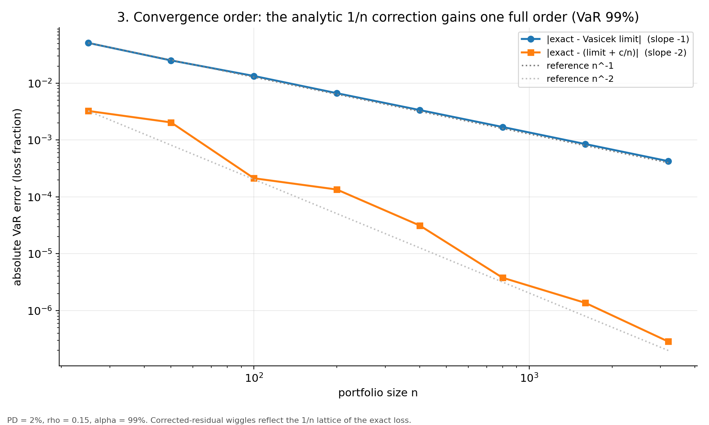
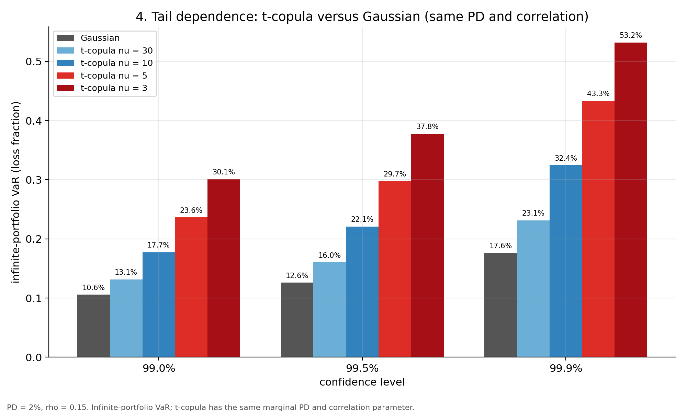
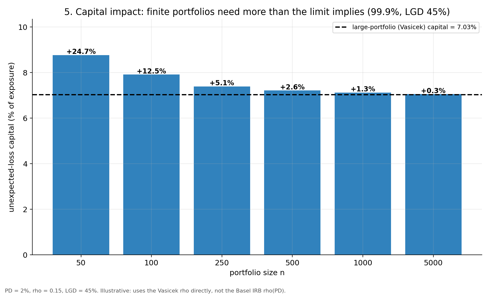

# mixed-binomial-credit-risk

[](https://github.com/nasaamit005/mixed-binomial-credit-risk/actions/workflows/ci.yml)
[](LICENSE)
[](pyproject.toml)
[](https://nasaamit005.github.io/mixed-binomial-credit-risk/)

**Exact finite-sample accuracy of the Vasicek large-portfolio approximation, with a validated analytic correction.**

**[Live interactive results](https://nasaamit005.github.io/mixed-binomial-credit-risk/)** &nbsp;|&nbsp;
[Derivation](docs/DERIVATION.md) &nbsp;|&nbsp; [Results log](docs/RESULTS.md) &nbsp;|&nbsp; [Data guide](docs/DATA.md)

**Author:** Amit Singh &nbsp;·&nbsp; **GitHub:** [@nasaamit005](https://github.com/nasaamit005)

---

## 1. Overview

Regulatory and internal credit-risk models routinely assume a *large, perfectly granular* portfolio, which
yields the closed-form Vasicek loss distribution. Real portfolios (SME books, mid-market loans, concentrated
corporate exposures) are finite. This project asks:

> **How accurate is the Vasicek large-portfolio approximation for finite portfolios, how large is the
> tail-risk error, and can it be corrected analytically?**

The Python package `mbcr` answers this with an **exact, noise-free benchmark**: for the one-factor model, the
loss distribution of an n-obligor portfolio is a *mixed binomial*, which is computed by deterministic numerical
integration, so differences from the Vasicek limit are free of Monte Carlo error. On top of this benchmark
the package provides:

- a **closed-form 1/n granularity correction** for VaR and Expected Shortfall, validated against the exact law;
- **extensions**: Student-t copula (tail dependence), two-factor sector structure, heterogeneous portfolios,
  stochastic (Beta) LGD;
- **Monte Carlo with importance sampling** for deep-tail validation, with batch-means standard errors;
- **calibration** of (PD, rho) by maximum likelihood and Bayesian MCMC;
- **capital impact** against the Basel IRB corporate formula;
- an **interactive results page** and a **Streamlit dashboard**.

## 2. Key results

Baseline: PD = 2%, asset correlation rho = 0.15, Gaussian one-factor model. Full detail and caveats are in
[`docs/RESULTS.md`](docs/RESULTS.md); every number is reproducible (see section 8).

| Finding | Evidence |
|---|---|
| The Vasicek limit **understates** tail risk for finite portfolios. At n = 100, 99.9% VaR is 19.58% against 17.63% (+11.1%); ES is 23.15% against 20.94% (+10.5%). | Exact quadrature |
| The error decays like 1/n. | `test_error_decays_like_one_over_n` |
| The analytic 1/n term removes the first-order error: the 99.9% VaR residual at n = 100 falls from +1.95e-2 (plain limit) to -5.1e-4 (corrected), and at n = 500 from +4.0e-3 to -1.0e-5. The corrected residual is second order (~n^-2). | `test_correction.py` |
| Importance sampling centred exactly on the tail quantile **backfires** (effective sample size about 137 of 200,000). A shift of half the quantile gives roughly 8x lower standard error than plain Monte Carlo at 99.9%. | Shift sweep, `docs/RESULTS.md` R4 |
| Copula choice dominates granularity. Infinite-n 99.9% VaR: Gaussian 17.6%; t-copula nu = 30 -> 23.1%, nu = 10 -> 32.4%, nu = 5 -> 43.3%, nu = 3 -> 53.2%. | `vasicek.var_limit_t` |
| Capital (LGD 45%, 99.9% unexpected loss): large-portfolio limit 7.03% of exposure; n = 100 -> 7.91% (+12.5%); n = 1,000 -> 7.12% (+1.3%). | `capital.capital_gap` |
| Beta-distributed LGD with the same mean (45%) raises tail ES, 12.5% -> 12.8% (n = 200, PD 3%). | `simulation.py` |

## 3. Figures

Regenerate with `python scripts/make_charts.py` (needs `pip install -e ".[figures]"`).

| | |
|---|---|
|  |  |
|  |  |
|  | |

## 4. Mathematical framework

**Model.** Obligor *i* defaults when a latent variable falls below a threshold calibrated so that the
marginal default probability is exactly PD:

$$X_i=\sqrt{\rho}\,Z+\sqrt{1-\rho}\,\varepsilon_i,\qquad \text{default} \iff X_i\le \Phi^{-1}(\mathrm{PD})$$

Conditional on the systematic factor $Z\sim N(0,1)$, defaults are independent with probability

$$p(z)=\Phi\!\left(\frac{\Phi^{-1}(\mathrm{PD})-\sqrt{\rho}\,z}{\sqrt{1-\rho}}\right),\qquad L\mid Z\sim\mathrm{Bin}\big(n,\,p(Z)\big)$$

**Exact finite-n law (mixed binomial)**, computed by quadrature in `exact.py`:

$$P(L=k)=\binom{n}{k}\int_{-\infty}^{\infty}p(z)^{k}\,\big(1-p(z)\big)^{n-k}\,\varphi(z)\,dz$$

**Vasicek limit** ($n\to\infty$), the loss fraction converges to $p(Z)$ with quantile

$$q_\alpha^{\infty}=\Phi\!\left(\frac{\Phi^{-1}(\mathrm{PD})+\sqrt{\rho}\,\Phi^{-1}(\alpha)}{\sqrt{1-\rho}}\right)$$

**Source of the error.** The finite-n loss variance has a systematic and an idiosyncratic ("granularity") part,
and the Vasicek limit keeps only the first:

$$\mathrm{Var}\!\left(\tfrac{L}{n}\right)=\underbrace{\mathrm{Var}\big(p(Z)\big)}_{\text{systematic}}+\underbrace{\tfrac1n\,\mathbb E\big[p(Z)(1-p(Z))\big]}_{\text{idiosyncratic}}$$

**First-order correction** (Gordy / Martin-Wilde granularity-adjustment framework, specialised here to the
homogeneous Vasicek case in closed form). With $f$ the Vasicek density and $\sigma^2(q)=q(1-q)$:

$$\mathrm{VaR}_\alpha^{(n)}\approx q_\alpha^{\infty}-\frac{1}{2n\,f(q)}\frac{d}{dq}\Big[f(q)\,\sigma^2(q)\Big],\qquad
\mathrm{ES}_\alpha^{(n)}\approx \mathrm{ES}_\alpha^{\infty}+\frac{f(q)\,\sigma^2(q)}{2n\,(1-\alpha)}$$

For PD = 2%, rho = 0.15, alpha = 99.9%: VaR_n ~ 0.1763 + 1.999/n and ES_n ~ 0.2094 + 2.247/n. The full
step-by-step derivation, with every symbol mapped to code, is in [`docs/DERIVATION.md`](docs/DERIVATION.md).

**Lattice versus smooth quantiles.** L is integer-valued, so the lattice VaR jumps in steps of 1/n, an
artefact of the same order as the correction. `var_es_continuous` uses the continuity-corrected loss
(L + U - 1/2)/n to compare like with like; both versions are reported.

**Extensions.** Student-t copula (common chi-square mixing variable, tail dependence), a two-factor model
(global factor plus an independent sector factor per group), heterogeneous groups (PD, rho, exposure, LGD per
group) and Beta-distributed stochastic LGD are implemented in `models.py` and `simulation.py`. The t-copula
also has an exact finite-n law and an infinite-n VaR.

## 5. Validation strategy

Each analytical claim is backed by an automated test (32 tests, fixed seeds, run in CI).

| Claim | Check | Test file |
|---|---|---|
| The pmf is a probability distribution with mean equal to PD | normalisation and first moment | `test_exact.py` |
| Variance equals systematic plus idiosyncratic part | exact identity via the bivariate normal | `test_exact.py` |
| Finite-n results converge to the Vasicek limit at rate 1/n | monotone error, ratio test | `test_exact.py` |
| The 1/n correction beats the limit by an order of magnitude and is second order | four (PD, rho) pairs, two confidence levels, residual-scaling test | `test_correction.py` |
| Monte Carlo and importance sampling reproduce the exact law | agreement within standard error; ESS and variance reduction | `test_simulation.py` |
| t-copula simulation matches the exact t-copula law | quantile agreement | `test_simulation.py` |
| Calibration recovers known parameters | MLE and Bayesian recovery on synthetic data | `test_calibration_capital.py` |
| Seeds make results reproducible | identical output for identical seed | `test_simulation.py` |

## 6. Installation

Requires Python 3.10 or newer.

```bash
git clone https://github.com/nasaamit005/mixed-binomial-credit-risk.git
cd mixed-binomial-credit-risk

python -m venv .venv
source .venv/bin/activate          # Windows PowerShell: .venv\Scripts\Activate.ps1
python -m pip install -e ".[dev,app]"

pytest                             # expect: 32 passed
```

The distribution is named `mixed-binomial-credit-risk`; the importable package is `mbcr`.

## 7. Usage

**Exact finite-n risk versus the Vasicek limit and the 1/n correction**

```python
from mbcr import mixed_binomial_pmf, var_es_continuous, var_vasicek, es_vasicek
from mbcr.correction import granularity_coefficients

n, pd_, rho, alpha = 100, 0.02, 0.15, 0.999
var_n, es_n = var_es_continuous(mixed_binomial_pmf(n, pd_, rho), alpha)
print(var_n, es_n)                                   # 0.1958  0.2315
print(var_vasicek(pd_, rho, alpha),
      es_vasicek(pd_, rho, alpha))                   # 0.1763  0.2094

g = granularity_coefficients(pd_, rho, alpha)
print(g.var_inf + g.var_coeff / n)                   # 0.1963  (corrected VaR)
```

**Heterogeneous portfolio, t-copula, sector factors, stochastic LGD, importance sampling**

```python
from mbcr import Portfolio
from mbcr.simulation import simulate_losses, estimate_risk, default_is_shift

pf = Portfolio(n=[60, 40], pd=[0.01, 0.05], rho=[0.12, 0.20],
               ead=[1.0, 2.0], lgd=[0.45, 0.60], sector_rho=[0.05, 0.10])
losses, weights = simulate_losses(pf, 200_000, model="t", nu=5,
                                  lgd_model="beta", lgd_sd=0.25,
                                  is_shift=default_is_shift(0.999))
print(estimate_risk(losses, weights, 0.999))         # var, es, standard errors, ess
```

**Calibration of (PD, rho) from yearly default counts**

```python
import numpy as np
from mbcr.calibration import simulate_default_counts, fit_mle, fit_bayes

n_t = np.full(300, 2000)
d_t = simulate_default_counts(n_t, pd=0.02, rho=0.15)    # synthetic truth
print(fit_mle(d_t, n_t))                                 # pd ~ 0.021, rho ~ 0.159
```

**Capital impact against the large-portfolio limit**

```python
from mbcr.capital import capital_gap, irb_risk_weight
print(capital_gap(100, 0.02, 0.15, lgd=0.45))            # rel_gap ~ +12.5%
print(irb_risk_weight(0.01, 0.45))                       # ~0.92 (verify constants, see section 11)
```

## 8. Reproducing the results

| Command | Output | Approx. time |
|---|---|---|
| `pytest` | 32 tests | under 1 minute |
| `python scripts/run_grid.py` | `data/derived/error_grid.csv` (576 exact cases over n, PD, rho, alpha) | a few minutes |
| `python scripts/make_report.py` | `docs/index.html`, the interactive results page | 1-2 minutes |
| `streamlit run app/streamlit_app.py` | live dashboard with sliders | immediate |

All randomness uses the project-wide seed `SEED = 20261101` (`mbcr.models`); exact results use deterministic
quadrature and involve no random numbers.

## 9. Interactive outputs

- **[Live results page](https://nasaamit005.github.io/mixed-binomial-credit-risk/)** (GitHub Pages, built from
  `docs/index.html`): loss-density comparison, error heat-map over n and rho, convergence-order plot,
  Gaussian versus t-copula tail comparison, and capital impact.
- **Streamlit dashboard** (`app/streamlit_app.py`): sliders for PD, correlation, confidence level, LGD,
  portfolio size and t-copula degrees of freedom, with the same figures plus live exact-versus-limit metrics.

## 10. Repository structure

```
mixed-binomial-credit-risk/
├── src/mbcr/
│   ├── models.py          # factor models, Portfolio container, global seed
│   ├── exact.py           # exact mixed-binomial law, lattice / continuous VaR and ES
│   ├── vasicek.py         # infinite-n limit (Gaussian and t-copula)
│   ├── correction.py      # closed-form 1/n VaR and ES correction
│   ├── simulation.py      # Monte Carlo, importance sampling, batch-means errors
│   ├── calibration.py     # MLE, Bayesian Metropolis, FRED loader
│   ├── capital.py         # Basel IRB formula and finite-n capital gap
│   ├── analysis.py        # error-grid experiments
│   └── viz.py             # Plotly figures
├── tests/                 # 32 pytest tests
├── scripts/               # run_grid, make_report, fetch_fred, calibrate_fred
├── app/streamlit_app.py   # interactive dashboard
├── docs/                  # DERIVATION.md, RESULTS.md, DATA.md, index.html (live page)
├── data/                  # raw/ (git-ignored), derived/ (synthetic outputs)
└── .github/workflows/     # CI: ruff + pytest on Python 3.10, 3.11, 3.12
```

## 11. Limitations and scope

- **Not a new theorem.** The 1/n expansion is the established granularity-adjustment framework (Gordy;
  Martin and Wilde; Gordy and Luetkebohmert for the regulatory version). The contribution here is the closed
  form in the homogeneous Vasicek case, validation against the *exact* finite-n law, the lattice-versus-smooth
  distinction, and the extensions.
- **Asymptotic validity.** The correction is unreliable for very small, low-PD portfolios. On the 576-case
  grid, for PD <= 0.5% and n <= 50 half of the cases have a limit error above 100%, and the worst corrected
  relative residual is 41% (n = 25, PD 0.1%, rho = 0.05, alpha = 99.9%). For n >= 500 the corrected residual
  is at most 7.6% across the whole grid.
- **Exact t-copula law** uses a midpoint-quantile grid for the mixing variable (accurate for moderate nu,
  approximate for extreme tails); it is cross-checked against simulation.
- **Simulation-only extensions.** Two-factor and heterogeneous models have no exact law or closed-form
  correction yet.
- **Calibration data.** Federal Reserve charge-off and delinquency rates are loss-rate *proxies*, not default
  counts; calibration from them needs an assumed effective portfolio size and must be reported as a
  sensitivity analysis. The Freddie Mac workflow is documented but not yet executed.
- **Basel IRB.** The IRB constants are taken from the published Basel II/III corporate formula and are kept in
  one place (`capital.IRB_PARAMS`). **Verify them against the current BIS text and your jurisdiction's
  implementation before any publication or regulatory use.** The capital-gap comparison uses the Vasicek rho
  directly, not the IRB-prescribed rho(PD).
- **Novelty.** A systematic literature check is still required before claiming novelty in a paper.

## 12. Data and licensing

| Source | Use | Redistribution |
|---|---|---|
| Synthetic data (seeded) | exact engine, correction, tests | free to publish |
| Federal Reserve series via FRED | proxy calibration | public series, cite FRED |
| Freddie Mac Single-Family Loan-Level Dataset | real portfolios, LGD | **not redistributable**; download individually |
| Rating-agency default studies | PD by rating, yearly default rates | proprietary; cite, do not copy tables |
| BIS Basel framework text | IRB constants | public |

Raw data is never committed (`data/raw/` is git-ignored). See [`docs/DATA.md`](docs/DATA.md) for the full
guide and the Freddie Mac workflow.

## 13. Roadmap

- [ ] Literature check on granularity adjustments, to fix the novelty claim precisely
- [ ] Verify IRB constants against the current BIS text; use the IRB rho(PD) in the capital comparison
- [ ] Extend the 1/n correction to the t-copula
- [ ] Granularity correction for heterogeneous portfolios
- [ ] Execute the Freddie Mac calibration and LGD workflow
- [ ] Systematic (downturn) LGD correlated with the factor
- [ ] Paper draft in `paper/`

## 14. Background reading

Bibliographic details are given from memory; please verify them against the original sources before citing.

- Vasicek, O. (2002). The distribution of loan portfolio value. *Risk*, 15(12).
- Gordy, M. B. (2003). A risk-factor model foundation for ratings-based bank capital rules. *Journal of Financial Intermediation*, 12(3).
- Martin, R. and Wilde, T. (2002). Unsystematic credit risk. *Risk*, 15(11).
- Gordy, M. B. and Luetkebohmert, E. (2013). Granularity adjustment for regulatory capital assessment. *International Journal of Central Banking*, 9(3).
- Rockafellar, R. T. and Uryasev, S. (2002). Conditional value-at-risk for general loss distributions. *Journal of Banking and Finance*, 26(7).
- Basel Committee on Banking Supervision, *Basel Framework* (internal ratings-based approach to credit risk), bis.org.

## 15. How to cite

```bibtex
@software{singh2026mbcr,
  author  = {Singh, Amit},
  title   = {mixed-binomial-credit-risk: Finite-sample accuracy of the Vasicek large-portfolio approximation},
  year    = {2026},
  version = {0.1.0},
  url     = {https://github.com/nasaamit005/mixed-binomial-credit-risk}
}
```

A machine-readable [`CITATION.cff`](CITATION.cff) is included, so GitHub offers a "Cite this repository" button.

## 16. Author

**Amit Singh**, GitHub: [@nasaamit005](https://github.com/nasaamit005)

Questions, corrections and suggestions are welcome through
[GitHub Issues](https://github.com/nasaamit005/mixed-binomial-credit-risk/issues).

## 17. License and disclaimer

Released under the [MIT License](LICENSE). This software is provided for research and educational purposes. It
is not investment, risk-management or regulatory advice, and results must be independently validated before
any use in capital, pricing or regulatory reporting.
